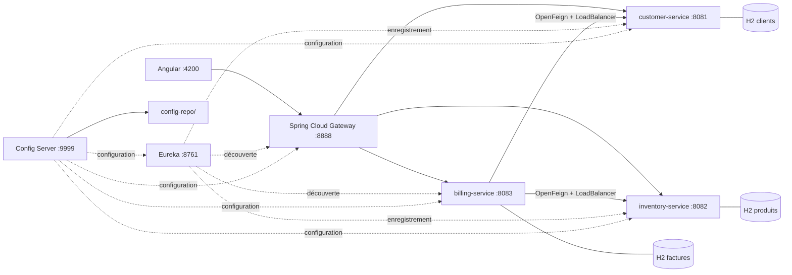
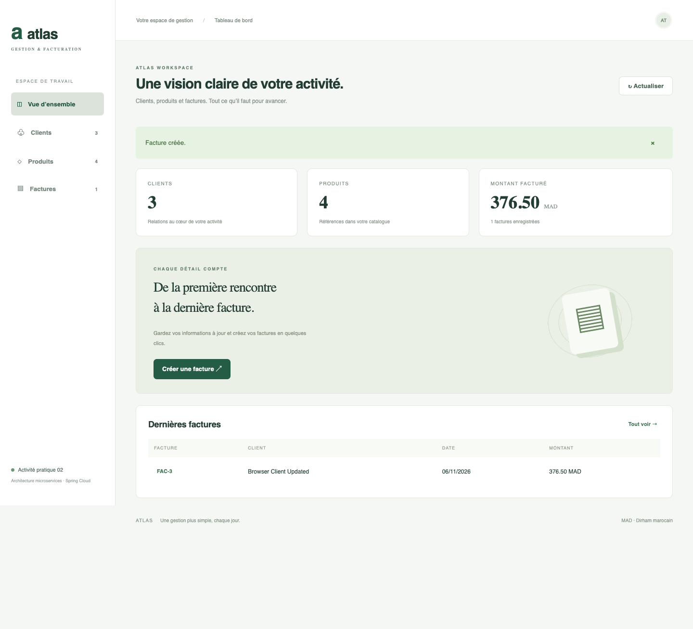

# Activité pratique n°2 — Architecture microservices avec Spring Cloud

Application de gestion de clients, de produits et de factures, avec un client Angular en français.

## Architecture



Java 21, Spring Boot 3.5.7, Spring Cloud 2025.0.0, Maven Wrapper, Angular 20.3, TypeScript 5.9. Les versions Boot/Cloud suivent la [matrice de compatibilité Spring](https://spring.io/projects/spring-cloud). Chaque service métier possède sa propre base H2 persistante dans `data/`.

## Démarrage rapide

Prérequis : JDK 21, Python 3, Node.js 24 LTS et npm. Les premiers builds nécessitent Internet. Aucune installation globale d’Angular ou de Maven n’est nécessaire.

Depuis la racine du dépôt :

```bash
# macOS, si Maven sélectionne un autre JDK
export JAVA_HOME=$(/usr/libexec/java_home -v 21)
# Sur cette machine, une installation Node 24 fonctionnelle est disponible ici :
export PATH="/opt/homebrew/opt/node@24/bin:$PATH"

./mvnw -B verify
python3 scripts/services.py start
cd angular-client
npm ci
npm start
```

Ouvrir [le client Angular](http://localhost:4200). Le script démarre Config Server, Eureka, les services métier, puis Gateway ; il attend leur disponibilité et la propagation des routes. Les journaux sont dans `logs/`. Les ports ci-dessous doivent être libres.

```bash
# Depuis la racine, dans un autre terminal
python3 scripts/services.py status
python3 scripts/smoke.py
python3 scripts/services.py stop
# Arrêter Angular avec Ctrl+C dans son terminal.
```

Deux clients et trois produits sont insérés au premier démarrage. Les factures sont créées depuis l’interface. Les données persistent lors d’un redémarrage. Chaque base est indépendante ; ne pas partager une même base entre plusieurs instances d’un service.

## Les neuf étapes et leurs commits

| Étape demandée | Réalisation | Commit |
|---|---|---|
| 1. Customer Service | Entité JPA, repository, API CRUD, validation, données initiales, tests | `521286c` |
| 2. Inventory Service | Produits, prix décimal, stock, CRUD, validation, tests | `7d5abc6` |
| 3. Spring Cloud Gateway | Application réactive sur le port 8888 | `7bbeca6` |
| 4. Routage statique | Profil `static`, destinations HTTP explicites | `4bac2b4` |
| 5. Eureka Discovery | Annuaire et clients Eureka | `32049c1` |
| 6. Routage dynamique | URI `lb://`, LoadBalancer et Discovery Locator | `6c662e6` |
| 7. Billing avec OpenFeign | Appels clients/produits, factures, lignes, totaux, instantanés | `28bf3ed` |
| 8. Configuration | Config Server, dépôt natif local, import par les services | `b0ff1aa` |
| 9. Client Angular | Tableau de bord, clients, produits, factures et impression | `355d7bc` |

Les commits suivants ajoutent la documentation, les scripts de lancement, la vérification intégrée et la mise en forme. Le premier commit d’origine est conservé ; les dates de commit sont réelles. Le squelette généré initialement est conservé dans `docs/initial-skeleton/` à titre de référence, hors compilation.

## Routage statique et dynamique

Par défaut, `GatewayRoutes` expose `/customers/**`, `/products/**` et `/bills/**` via les services découverts par Eureka. Le Discovery Locator expose aussi `/customer-service/**`, `/inventory-service/**` et `/billing-service/**`.

Pour démontrer le routage statique :

```bash
python3 scripts/services.py stop
python3 scripts/services.py start --static
python3 scripts/smoke.py
```

Le profil `static` désactive les routes Java dynamiques et utilise `application-static.yml` avec les adresses localhost. La facturation continue à utiliser Eureka pour ses appels OpenFeign.

## Services et API

| Service | Port | Entrée |
|---|---:|---|
| Config Server | 9999 | `/customer-service/default` |
| Eureka | 8761 | Interface web `/`, registre `/eureka/apps` |
| Customer | 8081 | `/customers` |
| Inventory | 8082 | `/products` |
| Billing | 8083 | `/bills`, `/bills/{id}/full` |
| Gateway | 8888 | `/customers`, `/products`, `/bills` |
| Angular | 4200 | Interface de gestion |

Chaque service expose `/actuator/health`. Clients et produits : `GET` collection/détail, `POST` création, `PUT /{id}` modification et `DELETE /{id}` suppression. Factures : `GET`, `POST`, `DELETE` ; pas de modification d’une facture émise. Réponses : 201 et `Location` à la création, 204 à la suppression, 400 pour les données invalides, 404 pour les ressources absentes, 503 si une dépendance de facturation est indisponible.

```bash
curl http://localhost:8888/customers
curl http://localhost:8888/products
# Adapter les identifiants aux données disponibles :
curl -i -X POST http://localhost:8888/bills \
  -H 'Content-Type: application/json' \
  -d '{"customerId":1,"items":[{"productId":1,"quantity":2},{"productId":2,"quantity":1}]}'
curl http://localhost:8888/bills/1/full
```

Une facture conserve le nom et l’email du client ainsi que le nom et le prix unitaire de chaque produit au moment de son émission. La modification ou suppression ultérieure de ces ressources ne change pas les factures existantes. Les montants utilisent `BigDecimal`, la devise de démonstration est MAD et aucun calcul fiscal n’est appliqué. Les lignes dupliquées sont rejetées. La quantité est contrôlée par rapport au stock, sans réservation ni décrémentation : ce TP traite la facturation, pas une transaction distribuée de gestion de commandes.

## Configuration centralisée

`config-service` utilise le backend natif de Spring Cloud Config. `config-repo/` est versionné dans ce même dépôt Git ; un dépôt Git distant séparé n’est pas nécessaire pour lancer le TP. `application.properties` contient les valeurs communes et les fichiers des services leurs valeurs propres.

Variables disponibles :

- `CONFIG_REPO` : chemin absolu du dossier de configuration, défini automatiquement par le script.
- `CONFIG_URL` : URL du serveur, par défaut `http://localhost:9999`.
- `EUREKA_URL` : URL du registre, par défaut `http://localhost:8761/eureka/`.

Les imports sont optionnels pour permettre l’exécution isolée avec les valeurs locales. Pour démontrer le serveur de configuration, le démarrer avant les clients ; consulter `http://localhost:9999/billing-service/default`. Redémarrer le service concerné après un changement de configuration. Aucun endpoint d’administration exposant les environnements n’est activé.

## Vérification

```bash
./mvnw -B verify
cd angular-client && npm ci && npm run build
# Dans un autre terminal, depuis la racine :
python3 scripts/services.py start
python3 scripts/smoke.py
```

Les tests automatisés vérifient le CRUD, les validations, les calculs exacts, les instantanés, l’absence de sauvegarde en cas d’erreur, les doublons, les ressources absentes et les erreurs OpenFeign. Le test intégré crée ses propres données, vérifie les routes, Eureka et Config Server, puis nettoie uniquement ses données. GitHub Actions compile et teste le backend, réalise le test intégré et compile Angular à chaque push.

Le client utilise un proxy de développement `/api` vers Gateway afin de servir les appels depuis la même origine. Pour un déploiement du build `angular-client/dist/client/browser`, configurer le serveur web pour relayer `/api/*` vers Gateway en supprimant `/api` et pour retourner `index.html` sur les routes du client.

Il s’agit d’un environnement pédagogique local, sans authentification ni paiement. Avant un déploiement public, ajouter les contrôles d’accès et la sécurisation adaptés.

## Ressource pédagogique

Énoncé : « Activité Pratique N°2 — Architecture Micro-services avec Spring cloud ». [Dépôt de référence de l’enseignant](https://github.com/mohamedYoussfi/micro-services-app). Le présent dépôt met en œuvre les neuf points de la capture fournie, avec une interface Angular et des vérifications supplémentaires.

## Aperçu



Voir le [compte rendu de vérification](docs/verification.md) et la [capture mobile](docs/screenshots/mobile.png).
