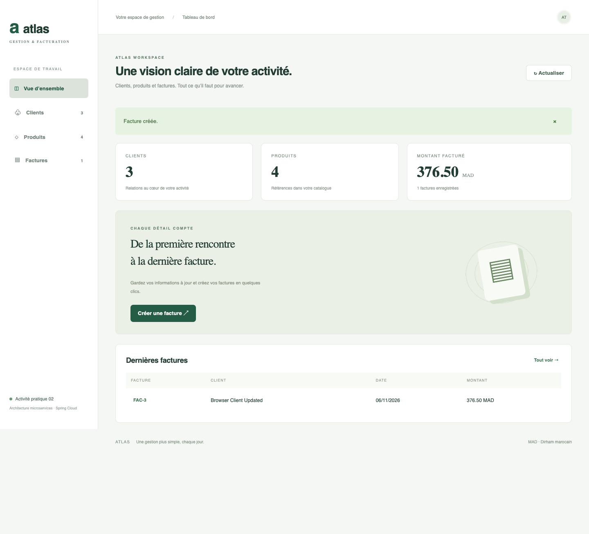
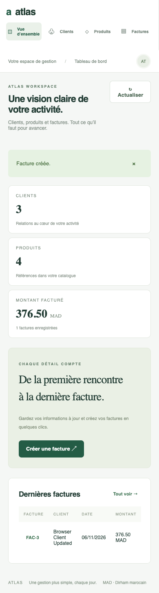

# Vérification du projet

Vérifications locales du 6 novembre 2026, avec Java 21 et Node 24.

| Vérification | Résultat |
|---|---|
| `./mvnw -B verify` | Six modules compilés, neuf tests réussis, aucune erreur |
| `npm ci` puis `npm run build` | Build Angular de production réussi, environ 222 kB avant compression |
| Tests intégrés via Gateway dynamique | CRUD clients/produits, création et lecture de facture, validations et nettoyage réussis |
| Tests intégrés via Gateway statique | Même parcours API validé avec le profil `static` |
| Eureka | Clients, inventaire, facturation et passerelle présents dans le registre |
| Spring Cloud Config | Configuration commune récupérée via `/customer-service/default` |
| OpenFeign | Récupération des clients et produits lors de la création d’une facture |
| Historique des factures | Changer le prix d’un produit ne modifie pas la facture déjà créée |
| Navigation dans Chrome | Création/modification client, création produit, émission d’une facture réussies |
| Calcul dans le navigateur | 3 × 125,50 MAD = 376,50 MAD |
| Affichage mobile | Vérifié à 390 px, sans débordement horizontal du tableau de bord |
| JavaScript | Aucune erreur d’exécution sur le parcours testé |

Les données générées par les tests intégrés et le navigateur sont supprimées après les tests. Les captures ci-dessous ont été prises pendant le test, avant nettoyage.

Pour reproduire la vérification intégrée : suivre le README, démarrer les services, puis lancer `python3 scripts/smoke.py`. La même commande est utilisable en profil statique.
